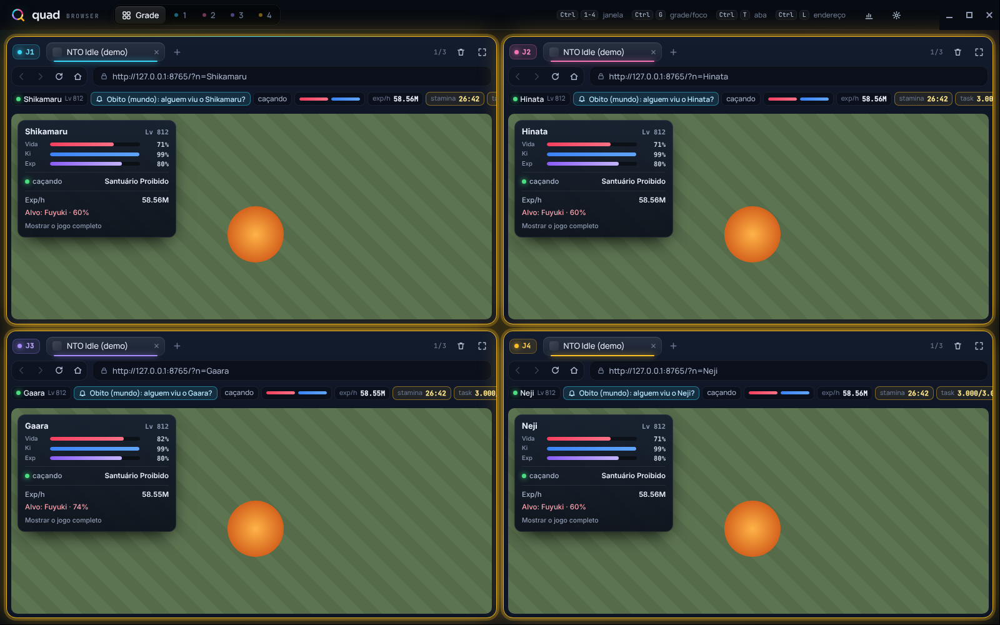
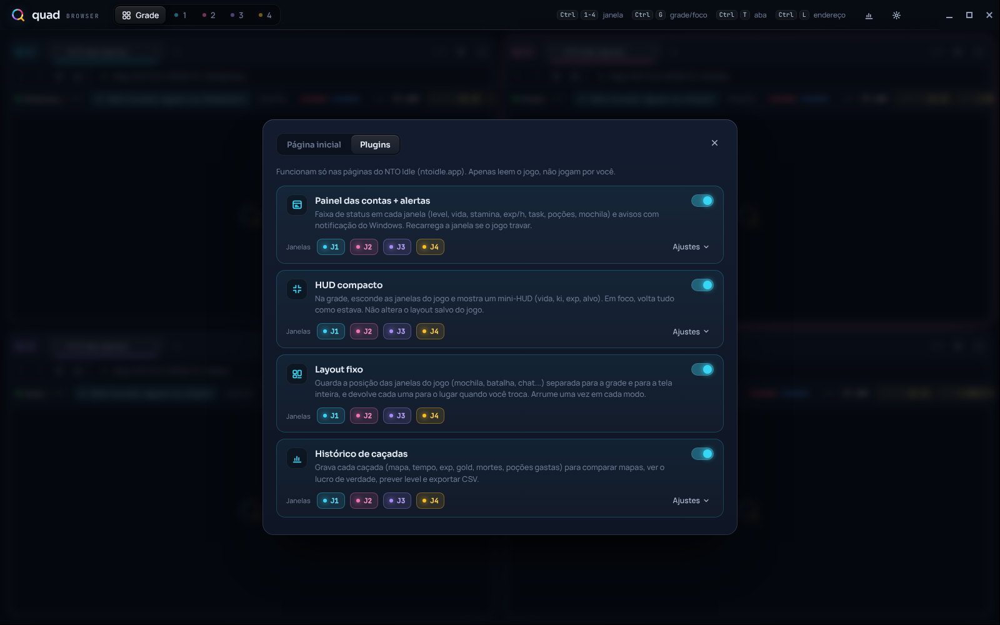
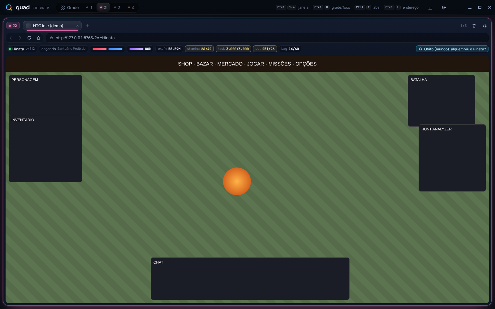
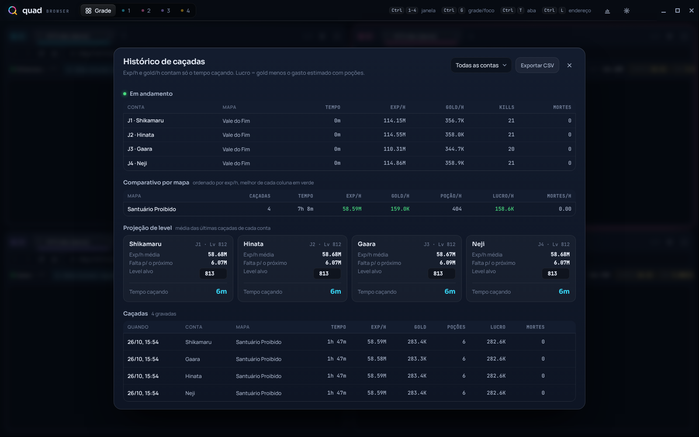

<div align="center">


# Quad Browser

**4 navegadores isolados numa janela só.** Cada um com seu próprio cache, cookies e login, até 3 abas cada, em grade ou em tela inteira.
Feito para quem joga com várias contas ao mesmo tempo, com plugins para o **NTO Idle**.

[Baixar a última versão](../../releases/latest) · [Plugins](#plugins-do-nto-idle) · [Atalhos](#atalhos) · [Desenvolvimento](#desenvolvimento)



</div>

## Por que existe

Abrir 4 contas do mesmo site no navegador comum exige 4 perfis, 4 janelas e muito Alt+Tab. O Quad Browser junta tudo: cada janela (J1 a J4) é uma sessão separada, então dá para ficar logado em 4 contas diferentes do mesmo site, ver todas lado a lado e abrir só uma quando precisar de atenção.

## Recursos

- **4 janelas isoladas**: cache, cookies e armazenamento separados por janela (o login de uma não vaza para a outra) e persistentes entre aberturas.
- **Até 3 abas por janela**, com barra de endereço, voltar, avançar, recarregar e página inicial.
- **Grade ou foco**: veja as 4 ao mesmo tempo ou só uma, pelo seletor no topo ou pelo teclado.
- **Página inicial configurável**: uma para todas ou uma por janela.
- **Limpar dados de uma janela só**, sem afetar as outras.
- **Layout fixo no NTO Idle**: as janelas do jogo (mochila, batalha, chat...) têm posição própria na grade e na tela inteira e voltam sempre para o mesmo lugar ao trocar de modo. Vem ligado, sem precisar configurar.
- **Atalhos que funcionam até dentro da página.**
- **Plugins** que podem ser ligados por janela.
- Interface escura com barra de título própria e tipografia embutida (funciona offline).

## Instalação

Na página de [Releases](../../releases/latest) há duas opções para Windows 10/11 (64 bits):

| Arquivo | Quando usar |
|---|---|
| `QuadBrowser-x.y.z-setup.exe` | Instala, cria atalho na Área de Trabalho e no Menu Iniciar. |
| `QuadBrowser-x.y.z-portable.exe` | Não instala nada: é só abrir. Bom para pendrive ou para testar. |

> O executável não tem assinatura digital paga, então o Windows SmartScreen pode avisar "O Windows protegeu o computador". Clique em **Mais informações** e depois em **Executar assim mesmo**. Se preferir, gere o seu próprio a partir do código (veja [Desenvolvimento](#desenvolvimento)).

Para abrir direto numa janela específica, crie um atalho com o argumento `--janela=N`:

```
"C:\...\Quad Browser.exe" --janela=2
```

## Atalhos

| Atalho | Ação |
|---|---|
| `Ctrl+1` a `Ctrl+4` | Ativa a janela (no modo foco, troca a janela exibida) |
| `Ctrl+G` / `F11` | Alterna grade e foco |
| `Ctrl+0` | Volta para a grade |
| `Ctrl+T` / `Ctrl+W` | Nova aba / fecha aba |
| `Ctrl+Tab` / `Ctrl+Shift+Tab` | Próxima / anterior aba |
| `Ctrl+L` / `F6` | Vai para a barra de endereço |
| `F5` / `Ctrl+R` | Recarrega |
| `Alt+←` / `Alt+→` | Voltar / avançar |
| `Ctrl+,` | Configurações (página inicial e plugins) |
| `Ctrl+H` | Histórico de caçadas |
| `F12` | DevTools da aba ativa |

## Plugins do NTO Idle

Em **Configurações → Plugins**, cada plugin tem uma chave geral, a escolha de em quais janelas roda (J1 a J4) e seus ajustes.



| Plugin | O que faz |
|---|---|
| **Painel das contas + alertas** | Faixa de status em cada janela: level, vida e ki, % de exp, exp/h, **Essência de Chakra Pura/h e Essência de Chakra/h**, stamina, task, poções e mochila. Avisa com notificação do Windows quando a stamina cai abaixo de 40h, poção está acabando, vida baixa, mochila cheia, task concluída, morte, personagem parado, saiu do mundo, PM, alguém citou seu nome ou palavras-chave que você escolher. Recarrega a janela se o jogo travar. |
| **HUD compacto** | Na grade, esconde as janelas do jogo e mostra um mini-HUD (vida, ki, exp, mapa, exp/h, essências/h, alvo). Em tela inteira, volta tudo. Não altera o layout salvo pelo jogo. |
| **Histórico de caçadas** | Grava cada caçada (mapa, tempo, exp, gold, essências, mortes, poções gastas). Mostra comparativo por mapa (exp/h, gold/h, essências/h, gasto/h, lucro/h), projeção de level com alvo e exporta CSV. |

<table>
<tr>
<td width="50%"></td>
<td width="50%"></td>
</tr>
<tr>
<td align="center"><sub>Tela inteira: faixa de status e aviso de citação no chat</sub></td>
<td align="center"><sub>Histórico: comparativo por mapa e projeção de level</sub></td>
</tr>
</table>

<sub>As imagens usam um jogo simulado (incluído em <code>dev/mock-nto</code>) só para demonstração.</sub>

### Como os plugins funcionam (e o que eles não fazem)

- Rodam **somente** em páginas de `ntoidle.app`.
- **Apenas leem** o estado que o próprio cliente do jogo já tem na página (`window.NTO.ctx`). Nenhum plugin envia comando ao servidor, clica, usa jutsu ou joga por você.
- A única ação automática é **recarregar a página** quando ela trava, igual a apertar F5.
- Tudo fica no seu computador, em `%APPDATA%\Quad Browser\`: `config.json` (página inicial), `plugins.json` (ajustes dos plugins) e `hunts.json` (histórico).

> Projeto de fã, **não oficial** e sem vínculo com o NTO Idle. Respeite as regras do jogo sobre ferramentas externas e múltiplas contas.

## Desenvolvimento

Requer [Node.js](https://nodejs.org) 20 ou mais recente.

```bash
git clone https://github.com/SEU-USUARIO/quad-browser.git
cd quad-browser
npm install
npm start               # abre em grade
npm run janela2         # abre direto na janela 2
npm run dist            # gera os .exe em dist/
```

No Windows também dá para dar dois cliques em `abrir.bat` (instala as dependências na primeira vez e abre).

### Estrutura

```
main.js              processo principal: janela, abas (WebContentsView), sessões, atalhos
preload.js           ponte segura entre a interface e o processo principal
ui/                  interface (HTML, CSS, JS, fontes e logo)
plugins/host.js      catálogo de plugins, injeção nas abas, leitura a cada 2s, alertas e histórico
plugins/sdk.js       roda dentro da página do jogo e monta o "retrato" da conta
plugins/*.js         um arquivo por plugin (layout.js é recurso padrão, sempre ligado)
dev/mock-nto/        jogo simulado para testar plugins sem login
build/               ícones do app
```

### Criando um plugin

1. Crie `plugins/meu-plugin.js`:

   ```js
   window.__qb.define('meu-plugin', (api) => ({
     start(settings) {},          // ao ligar
     configure(settings) {},      // quando os ajustes mudam
     onView(view) {},             // troca de grade/foco: { grid, w, h }
     tick(base) { return {}; },   // a cada 2s; base = retrato da conta
     stop() {},                   // ao desligar
   }));
   ```

   `api` oferece `base()`, `player()`, `client()`, `onChat(fn)`, `onState(fn)` e `emit('alert', { key, level, text })`.

2. Registre no `MANIFEST` de `plugins/host.js` (id, nome, descrição e campos de ajuste). A tela de plugins é gerada a partir dele.

3. Para testar sem login, sirva o jogo simulado e libere o host:

   ```bash
   cd dev/mock-nto && python -m http.server 8765
   # em outro terminal, na raiz do projeto:
   QB_PLUGIN_HOSTS=127.0.0.1 QB_PLUGIN_DEV=1 npm start
   ```

   No PowerShell: `$env:QB_PLUGIN_HOSTS='127.0.0.1'; $env:QB_PLUGIN_DEV='1'; npm start`.
   `QB_PLUGIN_DEV=1` relê os arquivos de plugin a cada recarga da aba.

### Publicando uma versão

O workflow `.github/workflows/release.yml` gera os dois `.exe` num runner Windows e anexa na Release:

```bash
npm version patch       # ou minor / major
git push --follow-tags
```

## Licença

[MIT](LICENSE) © 2026 João Victor Ferraz
